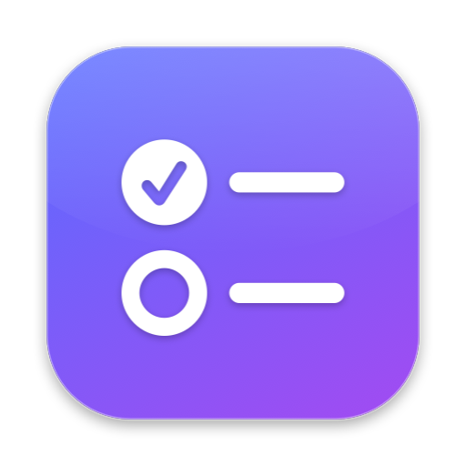

<p align="center"></p>

# TrackTasks

Нативный трекер задач для macOS, который сам выполняет задачи через Claude Code, Codex и другие агенты.

TrackTasks собирает все ваши проекты в одном окне. Задачи — обычные Markdown-файлы в папке `tasks/` проекта: их видно в git, их можно править в любом редакторе. Поставьте задачу в очередь, и агент выполнит её в фоне, а вы проверите изменения и сольёте их.

## Возможности

- **Проекты.** Карточки со статусом git, закреплённые проекты, «Сейчас в работе», хроника закрытых задач и коммитов.
- **Задачи в Markdown.** Чек-листы, критерии готовности, зависимости, вехи, шаблоны и граф.
- **Очередь агентов.** Параллельное выполнение в отдельных git worktree, волны по приоритету, цепочки, план до кода, пауза по лимиту.
- **Проверка результата.** Команда `verify`, ревью вторым запуском агента, diff, исправление замечаний, слияние и pull request через `gh`.
- **Чат и терминал.** Чат с Claude, поиск по сессиям, терминал прямо в карточке задачи.
- **Импорт.** Задачи из GitHub, Linear, Jira Cloud, GitLab и Sentry.
- **CLI и MCP.** Команда `tt` и MCP-сервер для скриптов и других агентов.
- **Личный режим.** Напоминания Apple рядом с рабочими задачами.
- **Расходы.** Стоимость запусков агентов и траты по проектам.

## Требования

- macOS 26 или новее, Apple Silicon или Intel
- git
- По желанию: [Claude Code](https://claude.com/claude-code) или Codex для агентов, `gh` для pull request

Без агентов TrackTasks работает как обычный трекер.

## Установка

### Homebrew

```sh
brew tap surfgoffdude/tracktasks
brew trust --cask surfgoffdude/tracktasks/tracktasks
brew install --cask surfgoffdude/tracktasks/tracktasks
```

Если в вашей версии Homebrew нет команды `brew trust`, пропустите её. Обновление: `brew update && brew upgrade --cask tracktasks`.

### Архив

Скачайте zip со страницы [Releases](https://github.com/SurfGoffDude/TrackTasks/releases/latest), распакуйте и перенесите `TrackTasks.app` в «Программы». Приложение подписано и нотаризовано Apple. Копия из архива сама не обновляется.

## Начало работы

1. Откройте TrackTasks и выберите папку с проектами. Ожидается структура `категория/проект`, например `~/Projects/Web/my-site`.
2. Экран первого запуска проверит окружение и предложит создать пример проекта.
3. Создайте задачу (⌘⇧N) и поставьте её в очередь.

Задача — файл `tasks/YYYYMMDD-HHMMSS-slug.md`:

```markdown
---
title: "Промокоды в корзине"
status: todo
priority: medium
created: 2026-11-25
completed:
---

Что сделать и зачем.

- [ ] Шаг работы

## Критерии готовности
- [ ] Проверяемое условие
```

## Данные и безопасность

- Проекты и задачи остаются в ваших папках, данные приложения — в `~/Library/Application Support/TrackTasks`. Своего сервера у TrackTasks нет.
- Агенты отправляют код и текст задач своим провайдерам по их правилам. Импорт, уведомления и pull request обращаются к сервисам, которые вы настроили.
- Агенты выполняют команды на вашем Mac. «Опасный режим» снимает запросы разрешений: включайте его, только если понимаете риск.

## Сборка из исходников

```sh
git clone https://github.com/SurfGoffDude/TrackTasks.git
cd TrackTasks
./build.sh --install
swift test
```

Подробно об устройстве, форматах и выпуске релизов — в [DEVELOPMENT.md](DEVELOPMENT.md).

## Лицензия

[GNU AGPL v3](LICENSE). Распространяете изменённую версию или даёте к ней доступ по сети — откройте её исходный код под той же лицензией.
